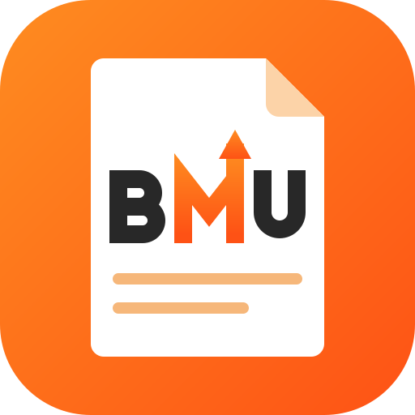

# BMU PDF app icon



**Design:** a white paper document with a folded corner on an orange field, lettered **BMU** in block
capitals drawn as strokes (no font). The M is orange and its right stroke rises into an arrow, after the
"build me up" arrow in BMU's own logo; two text lines below. The colours are BMU's, taken from
bmu.co.th (its `--primary-color` and logo gradient); the artwork itself is drawn fresh, not copied from
the logo file.

| Colour | Hex | Used for |
|---|---|---|
| BMU orange, light | `#fe8c20` | top-left of the field gradient, top of the M |
| BMU orange, deep | `#fe5215` | bottom-right of the field gradient, foot of the M |
| Charcoal | `#282828` | the B and the U |
| Paper | `#ffffff` | the document |
| Fold | `#fcd3a8` | the folded corner |
| Line peach | `#f6b77a` | the text lines |

**Tile:** `viewBox="0 0 512 512"`, a rounded square with `rx=112` that clips everything. Windows and Linux
icons use the full-bleed tile. macOS icons put it on Apple's grid (an 824 px body centred on a transparent
1024 px canvas). File names keep the upstream `pdfcraft` prefix so the build scripts need no change.

**Provenance:** original artwork drawn for BMU PDF as hand-written SVG on 2026-10-16, recoloured in BMU orange on 2026-10-20 (it replaces PdfCraft's
lion icon, which belongs to the upstream project). Every raster is rendered from `pdfcraft.svg` by
`packaging/icons.sh`. Licence: [LICENSE.txt](LICENSE.txt) (`MIT OR Apache-2.0`, like the repo).

## Files

| File | What it is |
|---|---|
| `pdfcraft.svg` | the master vector (traced at 2048 px); every PNG, `.ico` and `.icns` is rendered from it |
| `pdfcraft-small.svg` | a lighter vector (traced at 1024 px) for places where size matters, such as this README |
| `pdfcraft-1024.png` | 1024 px on Apple's grid; also the runtime Dock icon on macOS |
| `pdfcraft.icns` | macOS icon (16–1024 px) |
| `pdfcraft.ico` | Windows icon (16–256 px), embedded in `pdfcraft.exe` by `apps/pdfcraft/build.rs` |
| `pdfcraft-document.svg` | Windows PDF file icon master: a Lucide document outline, green badge and outlined PDF lettering; no font dependency |
| `pdfcraft-document.ico` | Windows PDF file icon (16–256 px), embedded as resource 2 in `pdfcraft.exe` |
| `hicolor/<n>x<n>/apps/ai.storyteller.pdfcraft.png` | Linux hicolor theme, 16–512 px; the 256 px one is the runtime icon on Windows and Linux |
| `hicolor/scalable/apps/ai.storyteller.pdfcraft.svg` | Linux scalable icon (copy of the master) |

Where it shows: `apps/pdfcraft/src/main.rs` sets the window icon (Dock, taskbar, Alt-Tab, launcher) and the
Wayland app id `ai.storyteller.pdfcraft`; `packaging/linux/ai.storyteller.pdfcraft.desktop` names the
hicolor icon.

Windows PDF files use resource 2 (`"pdfcraft.exe",-2`) when PdfCraft is chosen as the default
reader; the app keeps resource 1. The document outline is adapted from Lucide `file-text`
1.49.0 (ISC); its badge and outlined lettering are original (`MIT OR Apache-2.0`), covered by
[LICENSE-document.txt](LICENSE-document.txt). Both icons are embedded, requiring no runtime
sidecar. This provides a file type icon; first-page thumbnails still need a thumbnail provider.

## Regenerate

```sh
packaging/icons.sh        # needs resvg and python3; iconutil (macOS) for the .icns
cargo xtask assets        # then update the sha256 values in ATTRIBUTION.toml and run with --write
```
